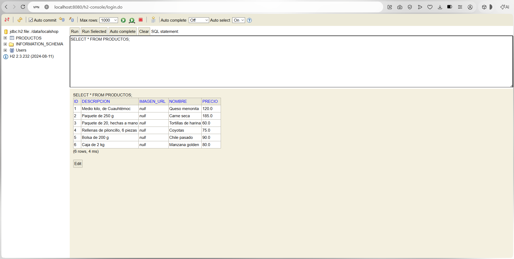
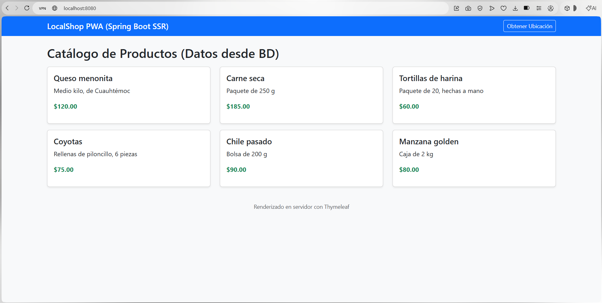
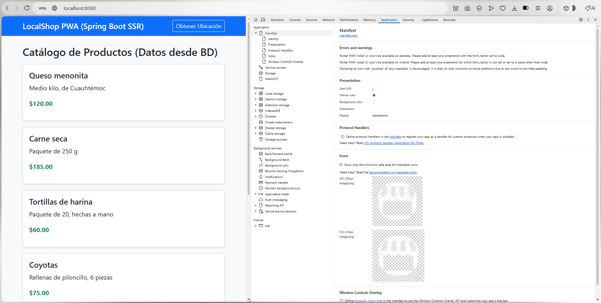
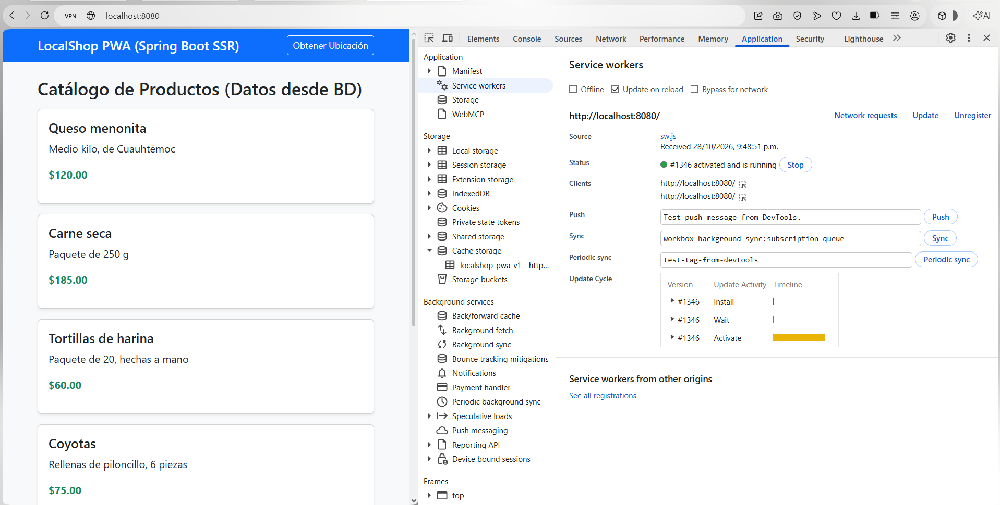
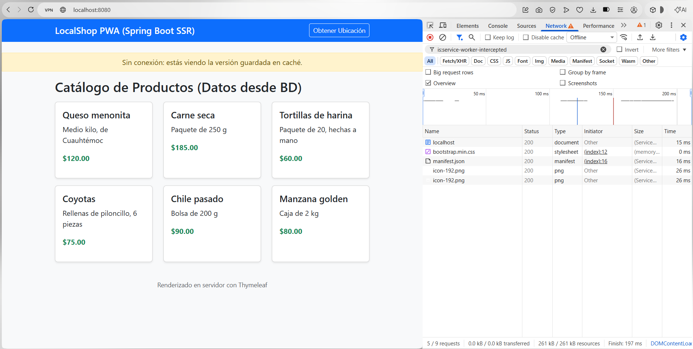
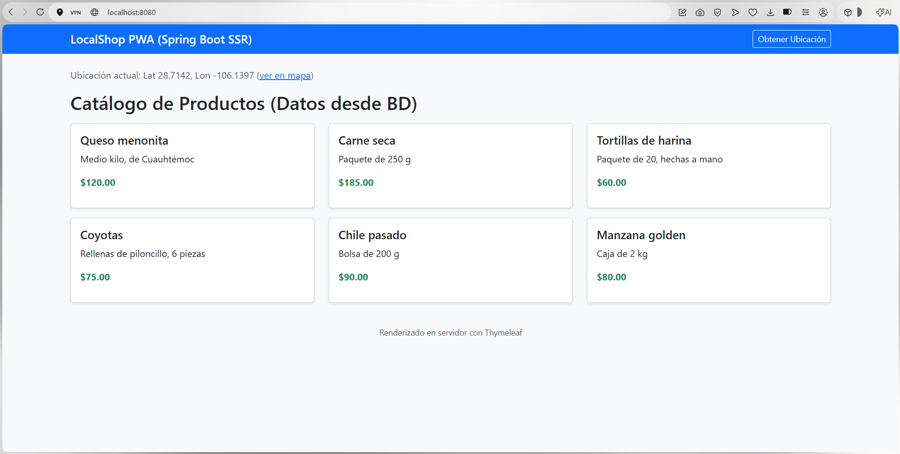
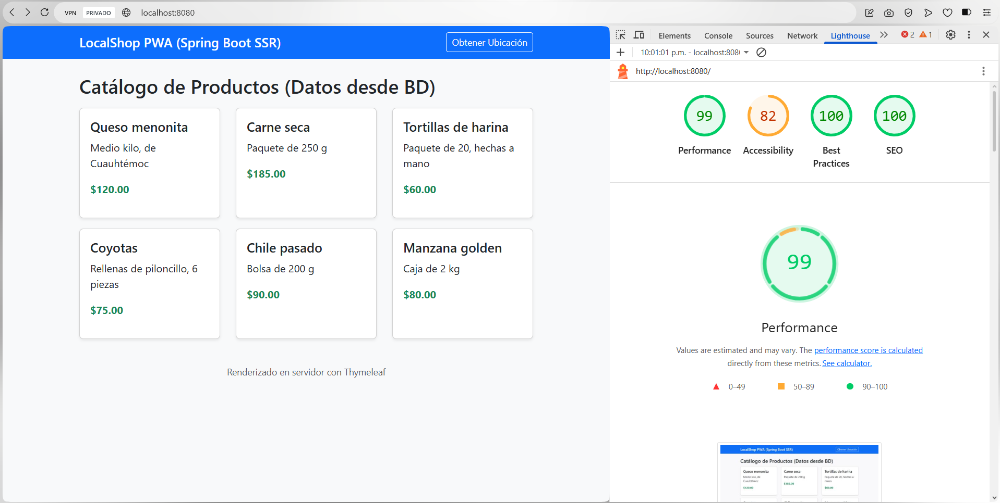
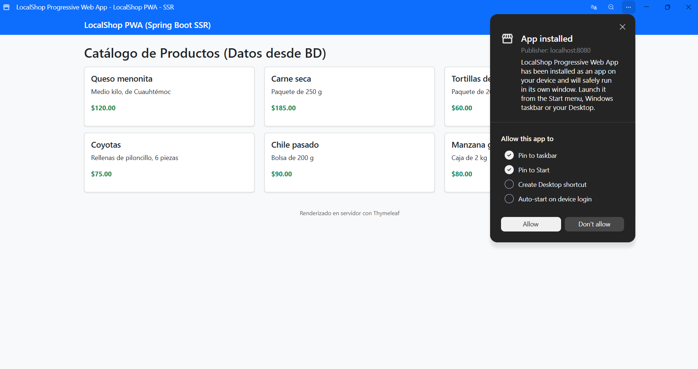

# localshop-pwa

Práctica de Aplicación Web Progresiva hecha con Java y Spring Boot. La página se renderiza en el servidor con Thymeleaf (SSR), los productos se leen de una base de datos con Spring Data JPA, y con el Service Worker la app se puede instalar y seguir abriendo sin internet. También usa la API de geolocalización del navegador.

El catálogo es de productos regionales de Chihuahua (queso menonita, carne seca, coyotas, etc.) que se cargan solos la primera vez que se corre el proyecto.

## Autores

- Jáuregui Iracheta Víctor Yahir – 1123150007
- Medellín Salcedo Santiago – 1123150022
- Molina Reza Omar Gael – 1123150030
- Ramos Juárez Brenda Regina 1123150013
- Rodríguez González Emmanuel – 1123150015
- Sidas Rodríguez Pedro Arturo – 1123150002

Grupo IDGS101N

## Tecnologías

- Java 21
- Spring Boot 3.5 (Web, Data JPA, Thymeleaf, DevTools)
- Lombok
- H2 (guardada en archivo, en la carpeta `data/`)
- Bootstrap 5.3 por CDN

## Estructura

```
localshop/
├── pom.xml
└── src/main/
    ├── java/com/pwa/localshop/
    │   ├── LocalShopApplication.java
    │   ├── config/DataLoader.java          -> carga productos de prueba
    │   ├── controller/ProductoController.java
    │   ├── model/Producto.java
    │   └── repository/ProductoRepository.java
    └── resources/
        ├── application.properties
        ├── templates/index.html            -> vista SSR / App Shell
        └── static/
            ├── manifest.json
            ├── sw.js
            └── images/icon-192.png, icon-512.png
```

Se sigue el patrón MVC: `Producto` es el modelo, `index.html` la vista y `ProductoController` el controlador. El repositorio es el que habla con la base de datos.

## Fases de desarrollo

### Etapa 1: Base de datos y modelo

Se creó la entidad `Producto` con las anotaciones de JPA (`@Entity`, `@Table`, `@Id`) y Lombok para no escribir getters y setters. Hibernate crea la tabla `productos` solo por la propiedad `spring.jpa.hibernate.ddl-auto=update`.

`ProductoRepository` extiende de `JpaRepository`, así que ya trae `findAll()`, `save()`, etc. El controlador usa `findAll()` y manda la lista a la vista con `Model`.

Para no tener la tabla vacía agregamos la clase `DataLoader`, que inserta 6 productos al arrancar solo si la tabla no tiene registros.



### Etapa 2: Manifiesto y App Shell

El `manifest.json` tiene el nombre de la app, los iconos (192 y 512), el color del tema y `display: standalone` para que al instalarla se abra como app y no como pestaña del navegador.

La vista `index.html` es el App Shell: la barra de navegación y el contenedor siempre son iguales y lo que cambia es la lista de productos, que llega ya armada desde el servidor con `th:each`. Ahí mismo se registra el Service Worker y está el botón de ubicación.





### Etapa 3: Service Worker y modo offline

En el evento `install` se guardan en caché los archivos del shell (la página principal, el manifiesto, Bootstrap y los iconos). Para las demás peticiones se usa la estrategia *network first*: primero intenta traer de la red y guarda una copia; si no hay conexión responde con lo que haya en la caché.

Cosas que le agregamos al código base:
- Evento `activate` que borra cachés de versiones anteriores.
- Se ignoran las peticiones que no son GET o que no son http (las extensiones de Chrome provocaban un error al hacer `cache.put`).
- Si se navega a una página que no está guardada, se regresa la principal.
- En la página aparece un aviso amarillo cuando se pierde la conexión.





### Geolocalización

Al presionar "Obtener Ubicación" el navegador pide permiso y se muestran la latitud y longitud, con un enlace para verla en Google Maps. Si se niega el permiso se muestra un mensaje.



### Auditoría con Lighthouse



## Cómo ejecutarlo

Requisitos: JDK 21 y Maven (o IntelliJ, que ya trae Maven).

```bash
git clone https://github.com/perrohambreado/localshop-pwa.git
cd localshop-pwa
mvn spring-boot:run
```

Abrir en Chrome: http://localhost:8080

Desde IntelliJ también se puede correr directo con el botón de play en `LocalShopApplication`.

### Consola de la base de datos

http://localhost:8080/h2-console

- JDBC URL: `jdbc:h2:file:./data/localshop`
- Usuario: `sa`
- Contraseña: (vacía)

### Usar MySQL en lugar de H2

1. Descomentar la dependencia `mysql-connector-j` en el `pom.xml`.
2. En `application.properties` comentar el bloque de H2 y descomentar el de MySQL con su usuario y contraseña.
3. La base `localshop` se crea sola por el parámetro `createDatabaseIfNotExist=true`.

### Probar el modo offline

1. Abrir la app y recargar una vez para que el Service Worker termine de instalarse.
2. DevTools (F12) > Application > Service Workers: debe aparecer `sw.js` como *activated and is running*.
3. En la pestaña Network marcar **Offline** (o detener el servidor) y recargar. La página sigue cargando desde la caché.

### Instalar la app

En Chrome aparece el icono de instalar en la barra de direcciones (o menú > *Instalar LocalShop*).



> Nota: el Service Worker y la geolocalización solo funcionan en `localhost` o con HTTPS. Si se abre desde el celular usando la IP de la computadora no van a funcionar.